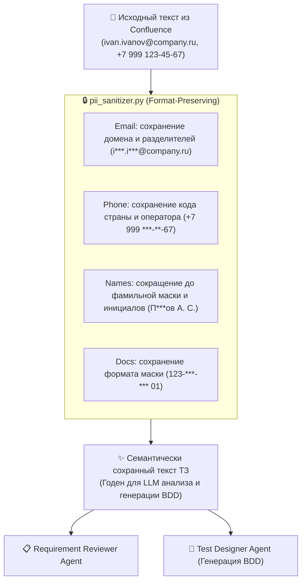

# 🔒 Регламент структурного маскирования чувствительной информации (Format-Preserving PII Policy)

> **Назначение документа:**  
> Данный регламент определяет правила **структурного (семантически сохраняющего) маскирования** персональных данных (PII) при передаче спецификаций из Confluence Cloud в мультиагентную систему тестирования OpenCode.

---

## 1. Почему полное маскирование `[EMAIL_REDACTED]` недопустимо

Полная замена на монолитный тег `[EMAIL_REDACTED]` или `[PHONE_REDACTED]` разрушает логику работы AI-агентов:

1. **Потеря бизнес-смысла для аналитика:**
   * *Было в ТЗ:* «Пользователь вводит email вида `ivan.ivanov@company.ru`, система проверяет домен `company.ru`».
   * *После грубого маскирования:* «Пользователь вводит `[EMAIL_REDACTED]`, система проверяет домен `[EMAIL_REDACTED]`».  
     Агент теряет понимание, что домен — это часть email, и не может сгенерировать тест-кейсы на валидацию доменной зоны.
2. **Неразличимость ролей и сущностей:**
   * Если в ТЗ есть 3 адреса: `client.vip@company.ru` (клиент), `support@company.ru` (техподдержка) и `admin@company.ru` (администратор) — грубое маскирование превратит их в одинаковые `[EMAIL_REDACTED]`. Агент не сможет различить ролевую модель и сценарии доступа.
3. **Разрушение трассируемости:**
   * Невозможно сопоставить тест-кейс со специфическим требованием, если все сущности стали одинаковыми строками.
4. **Необратимость:**
   * Из `[EMAIL_REDACTED]` невозможно восстановить тестовые фикстуры и структуру данных.

---

## 2. Стандарт структурного маскирования (Format-Preserving Masking)

Мы применяем **структурное маскирование**, при котором скрываются персональные данные конкретного человека, но **полностью сохраняются синтаксис, домены, роли и различимость**:

| Категория данных | Исходное значение | Структурное маскирование | Что сохраняется для агента |
| :--- | :--- | :--- | :--- |
| **Email клиента** | `ivan.ivanov@company.ru` | `i***.i***@company.ru` | Домен `@company.ru`, структура из двух частей через точку, тип поля |
| **Email поддержки** | `support@company.ru` | `s***t@company.ru` | Ролевой признак, корпоративный домен, отличие от клиента |
| **Email администратора** | `admin.sec@corp.net` | `a***.s***@corp.net` | Домен `@corp.net`, ролевое отличие |
| **Телефон (РФ / СНГ)** | `+7 (999) 123-45-67` | `+7 (999) ***-**-67` | Код страны `+7`, DEF-код оператора `999`, формат маски ввода |
| **ФИО в метаданных** | `Петров Алексей Сергеевич` | `П***ов А. С.` | Принадлежность к персоналиям, инициалы, отсутствие раскрытия личности |
| **СНИЛС** | `123-456-789 01` | `123-***-*** 01` | Маска СНИЛС для валидатора, отсутствие реального номера |
| **Паспорт РФ** | `45 10 123456` | `45 10 ***456` | Серия региона (45 10), последние цифры, факт наличия паспорта |
| **API-токены / пароли** | `ATATT3xFfGF0w...` | `[SECRET_ATLASSIAN_TOKEN]` | Тип секрета без раскрытия самого ключа |

---

## 3. Исключения (Whitelist / Белый список)

Следующие сущности **НЕ маскируются**:
1. **Синтетические фикстуры валидации из ТЗ:**
   * `user@example.com`, `test@test.com`, `@example.org`.  
   Они являются неотъемлемой частью критериев приемки (REQ-REG-002) и должны напрямую проверяться в тестах.
2. **Системные роли стейкхолдеров без персоналий:**
   * `Product Owner`, `Business Analyst`, `QA Lead`, `Solution Architect`.

---

## 4. Схема работы в конвейере OpenCode



---

## 5. Использование автономного скрипта

```bash
# Проверка и структурное маскирование файла
python pii_sanitizer.py requirements/CONF-PAGE-2031617.md

# Запуск демонстрационного тестирования
python pii_sanitizer.py
```
