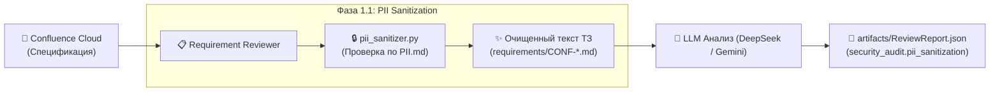

# 🔒 Регламент маскирования чувствительной информации (PII & Sensitive Data Policy)

> **Назначение документа:**  
> Данный регламент определяет правила автоматического выявления и маскирования персональных данных (PII — Personally Identifiable Information) и коммерческой тайны при импорте спецификаций из Confluence Cloud в мультиагентную систему тестирования OpenCode.

---

## 1. Зачем нужно маскирование PII

В реальных enterprise-проектах спецификации Confluence часто содержат:
- Персональные данные стейкхолдеров (ФИО авторов, аналитиков, продакт-оунеров).
- Контактные данные (корпоративные и личные email, номера мобильных телефонов).
- Служебные токены, пароли к тестовым средам, API-ключи.
- Номера документов при описании интеграций (СНИЛС, паспортные данные, номера банковских карт).

**Цель:** Обеспечить соответствие требованиям регуляторов (152-ФЗ, GDPR) и исключить утечку персональных данных в открытые логи, отчеты Quality Gate, тикеты Jira и публичные репозитории.

---

## 2. Категории чувствительных данных и правила подстановки

| Категория PII | Что ищем (Паттерн) | Шаблон маскирования | Пример до $\rightarrow$ после |
| :--- | :--- | :--- | :--- |
| **Email адреса** | Корпоративные и личные адреса `user@domain.com` | `[EMAIL_REDACTED]` | `ivan.ivanov@company.ru` $\rightarrow$ `[EMAIL_REDACTED]` |
| **Номера телефонов** | Форматы РФ (`+7`, `8`) и международные форматы | `[PHONE_REDACTED]` | `+7 (999) 123-45-67` $\rightarrow$ `[PHONE_REDACTED]` |
| **ФИО в метаданных** | Имена авторов, владельцев, согласующих (в блоках Автор / Владелец / Approved by) | `[NAME_REDACTED]` | `Автор: Анна Смирнова` $\rightarrow$ `Автор: [NAME_REDACTED]` |
| **Документы (СНИЛС/Паспорт)** | СНИЛС (`XXX-XXX-XXX XX`), серия и номер паспорта РФ | `[DOC_REDACTED]` | `СНИЛС: 123-456-789 01` $\rightarrow$ `СНИЛС: [DOC_REDACTED]` |
| **Секреты и токены** | API-ключи, Bearer-токены, Atlassian/GitHub токены | `[SECRET_REDACTED]` | `ATATT3xFfGF0w...` $\rightarrow$ `[SECRET_REDACTED]` |

---

## 3. Исключения (Whitelist / Белый список)

Маскированию **НЕ подлежат**:
1. **Синтетические тестовые фикстуры**, описанные в критериях приёмки требований:
   * Например: `user@example.com`, `test@test.com`, фиктивные домены `.example`, `.test`.
   * Они являются частью тестового контракта валидации поля (REQ-REG-002) и должны сохраняться для тест-дизайна.
2. **Системные роли стейкхолдеров без персоналий:**
   * `Product Owner`, `Business Analyst`, `QA Lead`, `Solution Architect` — сохраняются как роли.

---

## 4. Точка встраивания в мультиагентный конвейер



1. **Фаза 1.1:** Агент `requirement-reviewer` получает сырой контент страницы Confluence.
2. **Применение правил `PII.md`:** Текст пропускается через фильтры маскирования (модуль `pii_sanitizer.py`).
3. **Сохранение:** Очищенный текст без персональных данных сохраняется в `requirements/CONF-PAGE-{ID}.md`.
4. **Аудит безопасности:** В артефакт `artifacts/ReviewReport.json` добавляется блок `security_audit.pii_sanitization` с количеством скрытых записей.

---

## 5. Использование автономной утилиты `pii_sanitizer.py`

Для быстрой ручной или автоматической проверки файлов доступен CLI-скрипт:

```bash
# Проверка и очистка файла спецификации
python pii_sanitizer.py requirements/CONF-PAGE-2031617.md

# Вывод в консоль с отчетом аудита
python pii_sanitizer.py
```
