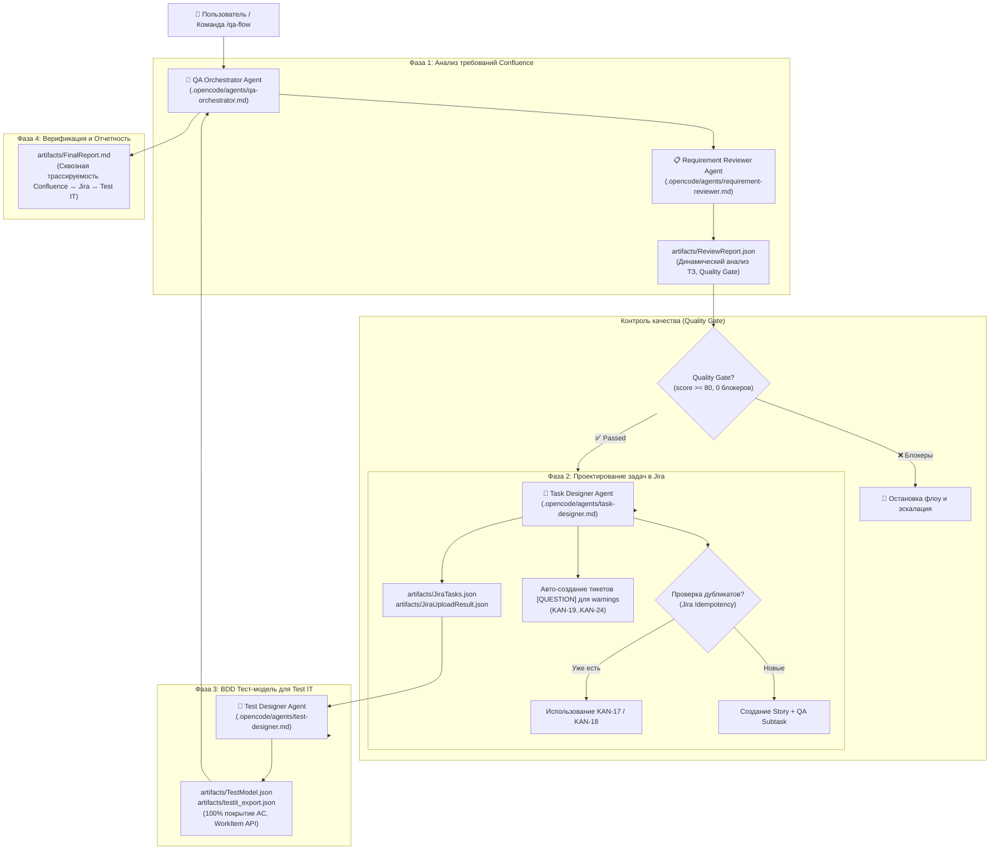

# 🤖 QA Multi-Agent System (OpenCode Project)

> **Автономная мультиагентная система обеспечения качества в среде OpenCode.**  
> Система построена на базе декомпозиции монолитных инструкций на 4 специализированных AI-агентов (`.opencode/agents/`), использующих выделенные `Skills` (`.opencode/skills/`), MCP-интеграции (Jira Cloud, Confluence Cloud) и формирующих тестовую модель для **Test IT TMS**.

---

## 📋 Выполненные требования преподавателя и методички

1. **Отказ от скриптового воспроизведения (No hardcoded scripts):**  
   Логика анализа требований, синтеза тестов, контроля Quality Gate и синхронизации с Jira выполняется **исключительно автономными AI-агентами в OpenCode**, а не через Python-скрипт с заранее подготовленными ответами.
2. **Глубокие самодостаточные инструкции субагентов:**  
   Каждый агент в `.opencode/agents/*.md` снабжен подробной инструкцией: зона ответственности (In/Out of Scope), входные данные, пошаговый алгоритм, используемые инструменты и контракты артефактов.
3. **Защита от повторного создания сущностей (Idempotency / Anti-Duplication):**  
   Перед созданием задач в Jira (`Story`, `QA Subtask`, `Questions`) и тест-кейсов в TMS агенты проверяют существующие записи по ключам, меткам и связям, предотвращая появление дубликатов при повторных запусках.
4. **Автоматическое создание задач на уточнение требований ([QUESTION]):**  
   При обнаружении «белых пятен» или предупреждений (warnings) в ТЗ агент `task-designer` автоматически создает в Jira тикеты типа `Задача` на Product Owner / Business Analyst и связывает их с родительской Story связью `Relates`.

---

## 🏗 Архитектура конвейера агентов



---

## 👥 Специализированные агенты

| Агент | Манифест | Подключенный Skill | Роль и ответственность |
| :--- | :--- | :--- | :--- |
| **`QA Orchestrator Agent`** | [qa-orchestrator.md](file:///.opencode/agents/qa-orchestrator.md) | — | Управление конвейером, контроль Quality Gate на каждом этапе, финальный аудит и формирование `FinalReport.md`. |
| **`Requirement Reviewer Agent`** | [requirement-reviewer.md](file:///.opencode/agents/requirement-reviewer.md) | `requirement-review` | Динамический анализ спецификаций Confluence, выделение FR/NFR, бизнес-правил, аудит белых пятен и расчет Quality Gate. |
| **`Task Designer Agent`** | [task-designer.md](file:///.opencode/agents/task-designer.md) | `task-design` | Защита от дубликатов в Jira, создание родительской Story, QA-подзадачи, авто-создание тикетов `[QUESTION]` по warnings. |
| **`Test Designer Agent`** | [test-designer.md](file:///.opencode/agents/test-designer.md) | `test-design` | Разработка BDD Gherkin тест-кейсов (Positive, Negative, Boundary, UI), экспорт WorkItems для Test IT TMS. |

---

## 📁 Структура проекта

```text
qa-multiagent-study/
├── .opencode/
│   ├── agents/                    # Полноценные системные инструкции 4-х агентов
│   │   ├── qa-orchestrator.md     # Primary Orchestrator
│   │   ├── requirement-reviewer.md # Анализ требований и Quality Gate
│   │   ├── task-designer.md       # Управление Jira и анти-дубликация
│   │   └── test-designer.md       # BDD тест-дизайн для Test IT
│   ├── skills/                    # Регламенты навыков (Skills)
│   │   ├── requirement-review/    # Скилл аудита требований Confluence
│   │   ├── task-design/           # Скилл работы с Jira и защиты от дубликатов
│   │   └── test-design/           # Скилл проектирования BDD тестов для TMS
│   └── commands/
│       └── qa-flow.md             # Сквозная команда OpenCode (/qa-flow)
│
├── opencode.jsonc                 # Конфигурация среды (MCP Jira, Confluence, Gemini, Cloud.ru)
├── AGENTS.md                      # Базовый регламент, контракты артефактов и роли
│
├── requirements/                  # Синхронизированные спецификации
│   ├── CONF-PAGE-2031617.md       # ТЗ: Модуль оформления заказа (релиз 2.4)
│   ├── CONF-BOOK-01.md            # ТЗ: Restful-Booker API v4.0
│   └── ...
│
└── artifacts/                     # Результаты автономной работы агентов
    ├── ReviewReport.json          # Отчет анализа требований (Quality Gate: 84/100, 6 warnings)
    ├── JiraTasks.json             # Валидированная задача Jira с привязанными вопросами
    ├── JiraUploadResult.json      # Результат выгрузки KAN-17, KAN-18 и KAN-19..KAN-24
    ├── TestModel.json             # 16 BDD тест-кейсов (100% покрытие AC)
    ├── testit_export.json         # Экспорт для Test IT TMS WorkItem API
    └── FinalReport.md             # Итоговый отчет и матрица трассируемости
```

---

## ⚡️ Инструкция по запуску в OpenCode

### Шаг 1: Открытие проекта в OpenCode
Откройте терминал в папке проекта:
```bash
cd C:\Users\Kosmos\qa-multiagent-study
opencode
```

### Шаг 2: Запуск конвейера
В чате OpenCode выполните команду:
```text
/qa-flow
```
Или отправьте текстовый запрос агенту:
> *«Проанализируй требования по странице Confluence 2031617, проверь Quality Gate, синхронизируй задачи с Jira с защитой от дубликатов и сформируй экспорт для Test IT TMS.»*

### Что произойдет автономно:
1. **Requirement Reviewer:** Считает спецификацию из Confluence, выделит 3 требования (`REQ-AUTH-001`, `REQ-REG-002`, `REQ-CHECKOUT-003`), 6 бизнес-правил, выявит 6 предупреждений и рассчитает Quality Gate (84/100, PASSED).
2. **Task Designer:** Проверит Jira на наличие существующих задач:
   - Обнаружит существующую Story `KAN-17` и QA-подзадачу `KAN-18` (не создавая дубликатов).
   - Обнаружит связанные тикеты вопросов `[QUESTION]` (`KAN-19` — `KAN-24`) и зафиксирует их связь.
3. **Test Designer:** Сформирует 16 BDD тест-кейсов со 100% покрытием критериев приемки и подготовит файл импорта `testit_export.json` для Test IT TMS.
4. **QA Orchestrator:** Соберет сквозную матрицу трассируемости и опубликует `FinalReport.md`.

---

## 🛡 Защита от дубликатов (Jira & TMS Idempotency)

Система гарантирует идемпотентность:
- **Jira Story:** Поиск существующего тикета по меткам (`conf-page-2031617`, `checkout`). Создание выполняется только при отсутствии задачи.
- **QA Subtask:** Проверка массива `fields.subtasks` у родительской задачи. При наличии тикета с префиксом `[QA] Test Execution` создание дубликата блокируется.
- **Jira Questions:** Проверка массива `fields.issuelinks` у родительской задачи. Тикеты на уточнение требований (`[QUESTION]`) создаются только для новых предупреждений, не представленных в Jira.
- **Test IT TMS:** Стабильная детерминированная схема идентификаторов `TC-SHOP-001`..`TC-SHOP-016` исключает дублирование кейсов при повторных выгрузках.

---

## 📊 Результаты и статус сущностей в Jira

| Сущность | Ключ | Назначение | Статус |
| :--- | :--- | :--- | :--- |
| **Story-родитель** | [KAN-17](https://kristapro.atlassian.net/browse/KAN-17) | Реализация модуля оформления заказа (Checkout) | ✅ Заведена |
| **QA-подзадача** | [KAN-18](https://kristapro.atlassian.net/browse/KAN-18) | `[QA] Test Execution` с комментарием DoD | ✅ Заведена |
| **Вопрос 1 (Dropdown ПВЗ)** | [KAN-19](https://kristapro.atlassian.net/browse/KAN-19) | `[QUESTION][REQ-CHECKOUT-003] Варианты и источник данных ПВЗ` | 🔗 Связан с KAN-17 |
| **Вопрос 2 (Пустой email)** | [KAN-20](https://kristapro.atlassian.net/browse/KAN-20) | `[QUESTION][REQ-REG-002] Поведение при пустом поле Email` | 🔗 Связан с KAN-17 |
| **Вопрос 3 (Валидация адреса/даты)** | [KAN-21](https://kristapro.atlassian.net/browse/KAN-21) | `[QUESTION][REQ-CHECKOUT-003] Маска и правила валидации полей` | 🔗 Связан с KAN-17 |
| **Вопрос 4 (Обязательные поля)** | [KAN-22](https://kristapro.atlassian.net/browse/KAN-22) | `[QUESTION][REQ-CHECKOUT-003] Список обязательных полей доставки` | 🔗 Связан с KAN-17 |
| **Вопрос 5 (Кнопка Войти)** | [KAN-23](https://kristapro.atlassian.net/browse/KAN-23) | `[QUESTION][REQ-AUTH-001] Состояние для авторизованного юзера` | 🔗 Связан с KAN-17 |
| **Вопрос 6 (Формат ошибки)** | [KAN-24](https://kristapro.atlassian.net/browse/KAN-24) | `[QUESTION][REQ-REG-002] Место и формат ошибки email` | 🔗 Связан с KAN-17 |
