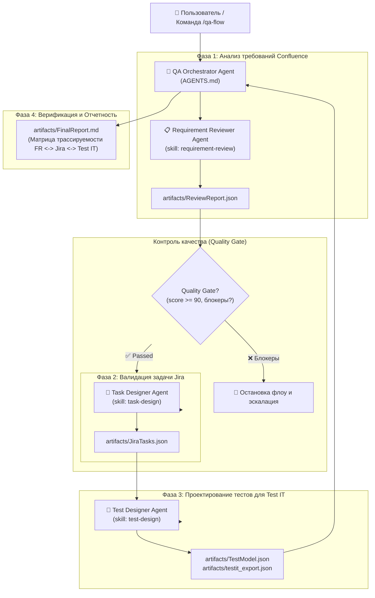

# 🤖 QA Multi-Agent System (OpenCode Study Project)

> **Учебный проект мультиагентной системы в OpenCode** по материалам домашнего задания.  
> Система построена на базе декомпозиции монолитных `Agent Instructions` на 4 специализированных AI-агентов с подключением `Skills` и формированием тестовой модели для **Test IT TMS**.

---

## 📋 Задание (Методичка)

1. **Декомпозировать Agent Instructions на специализированных агентов:**
   - **`Requirement Reviewer Agent`** — анализ требований (`requirement-review`).
   - **`Task Designer Agent`** — проектирование задач Jira (`task-design`).
   - **`Test Designer Agent`** — создание тестовой модели для Test IT (`test-design`).
   - **`QA Orchestrator Agent`** — управление агентами и контроль Quality Gate.
2. **Реализовать агентов и подключить ранее разработанные Skills** и необходимые интеграции в OpenCode.
3. **Настроить взаимодействие агентов.**
4. **Запустить флоу и проверить корректность работы агентов**, передачи данных и создания артефактов.

**Формат сдачи:** ссылка на GitHub-репозиторий с агентами, Skills, конфигурацией OpenCode, результатами выполнения и README с инструкцией по запуску.

---

## 🏗 Архитектура декомпозиции



### Сводная таблица этапов конвейера

| Этап | Специализированный Агент | Входные данные | Инструменты / MCP | Выходные артефакты |
| :--- | :--- | :--- | :--- | :--- |
| **1. Анализ требований** | `Requirement Reviewer` | Спецификация Confluence (`requirements/CONF-AUTH-01.md`) | `confluence` (`get`, `search`), `read` | `artifacts/ReviewReport.json` |
| **2. Контроль Quality Gate** | `QA Orchestrator` | `ReviewReport.json` | Внутренняя логика Quality Gate | При блокерах — тикет эскалации в Jira |
| **3. Задача Jira + Загрузка** | `Task Designer` | Задача Jira (`requirements/AUTH-101.json`), `ReviewReport.json` | `jira` (`create_issue`, `add_comment`) | `artifacts/JiraTasks.json`, `artifacts/JiraUploadResult.json` |
| **4. Тест-модель для Test IT** | `Test Designer` | `JiraTasks.json`, `ReviewReport.json` | Экспорт в Test IT WorkItem API | `artifacts/TestModel.json`, `artifacts/testit_export.json` |
| **5. Верификация и отчет** | `QA Orchestrator` | Все артефакты конвейера | Валидация контрактов из `AGENTS.md` | `artifacts/FinalReport.md` |

---

## 📁 Структура проекта

```text
qa-multiagent-study/
├── .opencode/                     # Конфигурация среды OpenCode
│   ├── agents/                    # Зарегистрированные роли 4-х агентов OpenCode
│   │   ├── qa-orchestrator.md     # Primary: QA Orchestrator Agent
│   │   ├── requirement-reviewer.md # Subagent: Requirement Reviewer Agent
│   │   ├── task-designer.md       # Subagent: Task Designer Agent
│   │   └── test-designer.md       # Subagent: Test Designer Agent
│   ├── skills/                    # Подключенные регламенты Skills
│   │   ├── requirement-review/    # Skill: requirement-review
│   │   ├── task-design/           # Skill: task-design
│   │   └── test-design/           # Skill: test-design (для Test IT TMS)
│   └── commands/
│       └── qa-flow.md             # Пользовательская команда OpenCode (/qa-flow)
│
├── opencode.jsonc                 # Файл конфигурации OpenCode (MCP Jira, Confluence, Cloud.ru LLM)
├── AGENTS.md                      # Декомпозиция 4-х агентов, правила взаимодействия, Artifact Storage и контракты
│
├── requirements/                  # Входные требования для флоу
│   ├── CONF-AUTH-01.md            # Спецификация Confluence (Архитектура)
│   ├── AUTH-101.json              # Задача Jira (JSON экспорт)
│   └── AUTH-101.xml               # Задача Jira (XML RSS экспорт)
│
├── artifacts/                     # Результаты выполнения (артефакты)
│   ├── ReviewReport.json          # Отчет анализа требований Confluence (Quality Gate)
│   ├── JiraTasks.json             # Валидированная задача Jira
│   ├── JiraUploadResult.json      # Результат загрузки подзадачи и комментария в Jira
│   ├── TestModel.json             # Тестовая модель с BDD-сценариями
│   ├── testit_export.json         # Готовый экспорт для Test IT WorkItem API
│   └── FinalReport.md             # Итоговый отчет и сквозная матрица трассируемости
│
├── run_flow.py                    # Исполняемый скрипт сквозной проверки флоу
└── README.md                      # Документация и инструкция по запуску
```

---

## 👥 Специализированные агенты

| Агент | Описание и регламент | Подключенный Skill | Роль и назначение |
| :--- | :--- | :--- | :--- |
| **`Requirement Reviewer Agent`** | `AGENTS.md` | `requirement-review` | Аудит архитектурной спецификации Confluence, выделение функциональных требований (FR-01..FR-04), расчет Quality Gate. |
| **`Task Designer Agent`** | `AGENTS.md` | `task-design` | Парсинг и валидация задачи Jira (`AUTH-101`), проверка критериев приемки (AC) и Definition of Done (DoD), загрузка подзадач в Jira через MCP. |
| **`Test Designer Agent`** | `AGENTS.md` | `test-design` | Синтез требований и задачи в BDD-сценарии Gherkin (Given/When/Then), тестовые данные, расчет severity/priority для **Test IT TMS**. |
| **`QA Orchestrator Agent`** | `AGENTS.md` | — | Управление конвейером, контроль прохождения Quality Gate, валидация контрактов данных, построение матрицы трассируемости. |

---

## ⚡️ Инструкция по запуску

### Способ 1: Запуск через скрипт валидации флоу (быстрый запуск)

Для быстрой проверки корректности взаимодействия агентов, передачи данных и генерации всех артефактов:

```bash
python run_flow.py
```

**Ожидаемый результат работы в консоли:**
```text
===========================================================================
🤖 OPENCODE QA MULTI-AGENT SYSTEM (STUDY)
🔌 Интеграции: Confluence, Jira (Upload/Write), Test IT TMS, MCP Protocol
===========================================================================

🚀 [Requirement Reviewer Agent]: Запуск анализа требований из Confluence...
🔹 [Requirement Reviewer Agent]: Подключен скилл 'SKILL.md'. Чтение спецификации CONF-SPEC-AUTH-01...
✅ [Requirement Reviewer Agent]: Выделено 4 требований. Score: 96/100
🔹 [Requirement Reviewer Agent]: Артефакт сохранен: ReviewReport.json
🚀 [QA Orchestrator Agent]: Проверка Quality Gate требований...
✅ [QA Orchestrator Agent]: Quality Gate PASSED: Блокирующих дефектов в требованиях нет. Переход к Фазе 2.
🚀 [Task Designer Agent]: Запуск валидации и сопоставления задачи Jira...
🔹 [Task Designer Agent]: Подключен скилл 'SKILL.md'. Анализ задачи AUTH-101...
✅ [Task Designer Agent]: Задача AUTH-101 сопоставлена с FR-01..FR-04. DoD: Пройден
🔹 [Task Designer Agent]: Артефакт сохранен: JiraTasks.json
🚀 [Test Designer Agent]: Создание тестовой модели BDD для Test IT TMS...
🔹 [Test Designer Agent]: Подключен скилл 'SKILL.md'. Генерация BDD сценариев...
✅ [Test Designer Agent]: Сгенерировано 4 BDD тест-кейсов для Test IT TMS
🔹 [Test Designer Agent]: Артефакты сохранены: TestModel.json, testit_export.json
🚀 [QA Orchestrator Agent]: Построение матрицы трассируемости и финальный аудит качества...
✅ [QA Orchestrator Agent]: Итоговый отчет сформирован: FinalReport.md

===========================================================================
🎉 МУЛЬТИАГЕНТНЫЙ ФЛОУ В OPENCODE УСПЕШНО ЗАВЕРШЕН ЗА 0.0 СЕК!
📁 Все артефакты сохранены в: .../qa-multiagent-study/artifacts
===========================================================================
```

### Способ 2: Запуск в интерфейсе OpenCode CLI

1. Убедитесь, что OpenCode установлен (`opencode --version`).
2. Перейдите в корень проекта:
   ```bash
   cd qa-multiagent-study
   ```
3. Запустите OpenCode:
   ```bash
   opencode
   ```
4. В интерфейсе OpenCode вызовите команду запуска сквозного конвейера:
   ```text
   /qa-flow
   ```

---

## 📊 Результаты выполнения (Артефакты)

Все результаты сохраняются в папке `artifacts/`:
1. **`ReviewReport.json`** — отчет анализа требований, включающий `spec_id`, `functional_requirements`, `business_rules`, `constraints` и `quality_gate`.
2. **`JiraTasks.json`** — разобранная задача `AUTH-101` с верификацией критериев приемки и статусом DoD.
3. **`JiraUploadResult.json`** — подтверждение создания подзадачи и комментария в Jira.
4. **`TestModel.json`** — тестовая модель с 4-мя детальными BDD-кейсами (Happy Path, Replay Attack, Brute-Force, TTL Boundary).
5. **`testit_export.json`** — экспорт тестовой модели в формат Test IT WorkItem API (`entityTypeName: "TestCases"`, steps, preconditions, priority, tags).
6. **`FinalReport.md`** — финальный отчет аудита с полной матрицей трассируемости:

| Требование Confluence | Задача Jira | Тест-кейсы Test IT | Статус покрытия |
| :--- | :--- | :--- | :--- |
| `FR-01` | `AUTH-101` | `TC-AUTH-001` | ✅ Full (100%) |
| `FR-02` | `AUTH-101` | `TC-AUTH-001`, `TC-AUTH-002` | ✅ Full (100%) |
| `FR-03` | `AUTH-101` | `TC-AUTH-003` | ✅ Full (100%) |
| `FR-04` | `AUTH-101` | `TC-AUTH-004` | ✅ Full (100%) |

---

## 📦 Формат сдачи

Репозиторий содержит полный комплект файлов, требуемых методичкой:
- ✅ **Декомпозиция Agent Instructions:** представлена в файле `AGENTS.md` (структура агентов, правила общения, контракты артефактов).
- ✅ **Специализированные агенты:** реализованы 4 роли (`requirement-reviewer`, `task-designer`, `test-designer`, `qa-orchestrator`).
- ✅ **Подключенные Skills:** папка `.opencode/skills/` с регламентами `requirement-review`, `task-design`, `test-design` (для Test IT).
- ✅ **Конфигурация OpenCode:** файлы `opencode.jsonc`, `AGENTS.md`, `.opencode/commands/qa-flow.md`.
- ✅ **Результаты выполнения:** артефакты в папке `artifacts/` (`ReviewReport.json`, `JiraTasks.json`, `JiraUploadResult.json`, `TestModel.json`, `testit_export.json`, `FinalReport.md`).
- ✅ **README.md** с пошаговой инструкцией по запуску и архитектурой.
